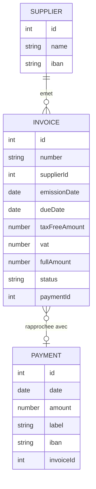
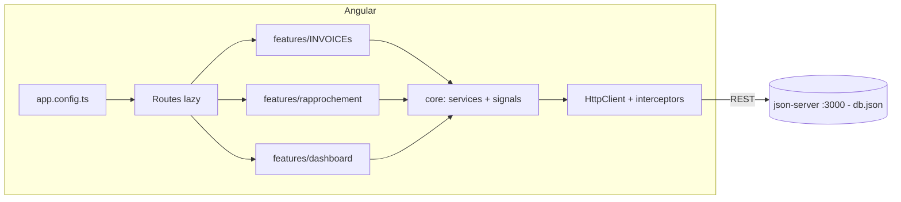
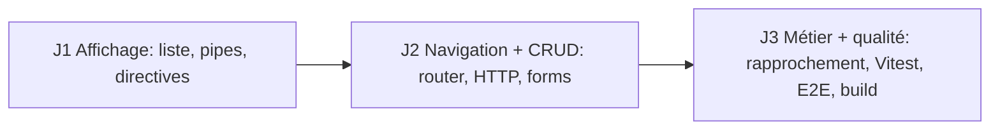

# Formation Angular — Projet fil rouge « Rapprochement de INVOICE »

> **Version 1.1.0 — 29/10/2026** · Angular 22.2 (CLI courante, standalone, signals, zoneless, OnPush) · Vitest · json-server 0.17.4

**Durée** : 3 jours × 7 h = 21 h · **Mode** : standalone, signals, control-flow, OnPush, Reactive Forms · **Backend** : json-server · **Tests** : Vitest + aperçu Playwright/Cypress

## Contenu du dossier
| Fichier | Rôle |
|---|---|
| [INDEX.md](INDEX.md) | Ce document |
| [JOUR-1.md](JOUR-1.md) | Fondations : CLI, standalone, template, control-flow, signals, pipes, directives, données |
| [JOUR-2.md](JOUR-2.md) | Routeur, lazy loading, DI, HttpClient/RxJS, Reactive Forms, communication, Material |
| [JOUR-3.md](JOUR-3.md) | Rapprochement, guards/interceptors, Vitest, aperçu E2E, sécurité, doc, build |
| [CHANGELOG.md](CHANGELOG.md) | Historique des versions |
| [Formation-Angular-22_Support-Apprenant.pptx](Formation-Angular-22_Support-Apprenant.pptx) | Support de révision apprenant (62 slides, notes formateur) |
| [backend/](../backend/README.md) | `db.json` prêt à l'emploi, `package.json`, `json-server.json`, `scripts/generate-db.mjs` |

## Démarrage du backend
```bash
cd backend && npm install && npm run api   # http://localhost:3000
```

## Le projet
Un comptable **rapproche** des INVOICEs SUPPLIERs avec des **PAYMENTs** (lignes de relevé bancaire).

- Lister / filtrer / trier les factures (statut, fournisseur, période)
- Consulter, créer, modifier une facture (Reactive Forms)
- Proposer des paiements candidats (montant TTC ± tolérance, date proche), valider le rapprochement
- Tableau de bord : totaux, taux de rapprochement, litiges

### Modèle de données


### Architecture cible


### Progression


## Couverture du programme
| Objectif du programme | Jour |
|---|---|
| Concepts clés, CLI, workspace, écosystème | J1 |
| Components, templates, binding, directives, pipes, @if/@for | J1 |
| Standalone vs modules, Shared, Material, routing, lazy | J2 |
| Reactive Forms, DI, HttpClient, RxJS | J2 |
| Tests (composant, service) avec Vitest, aperçu E2E, sécurité | J3 |
| Bonnes pratiques, JSDoc/Compodoc, mises à jour, IA pour schematics | J3 |

## Nouveautés Angular 22 à connaître
- **Signal Forms** et **resource()/httpResource()** sont stables ; les TP restent en Reactive Forms, Signal Forms est présenté comme alternative.
- **OnPush** et **zoneless** sont les défauts des nouveaux projets : plus besoin de les activer à la main.
- `ng generate service` produit un service `@Service()` ; `@Injectable({providedIn:'root'})` reste disponible via `--injectable`.
- **HttpClient** est fourni par défaut et utilise **Fetch** ; `withFetch()` n'est plus nécessaire.
- Nouveaux prérequis : **Node 22+** et **TypeScript 6**.

> Le programme PDF cite Protractor, Karma et Jasmine, désormais obsolètes : la formation utilise Vitest (`ng test`) et présente Playwright et Cypress pour l'E2E.

## Prérequis poste
Node 22 LTS ou plus récent, npm, Angular CLI 22 (`npm i -g @angular/cli`), VS Code (Angular Language Service), Git, navigateur avec DevTools.

## Rythme type
09:00–10:30 concept · 10:45–12:30 exemple + démo · 13:30–17:30 TP · 17:30–18:00 revue / quiz.
