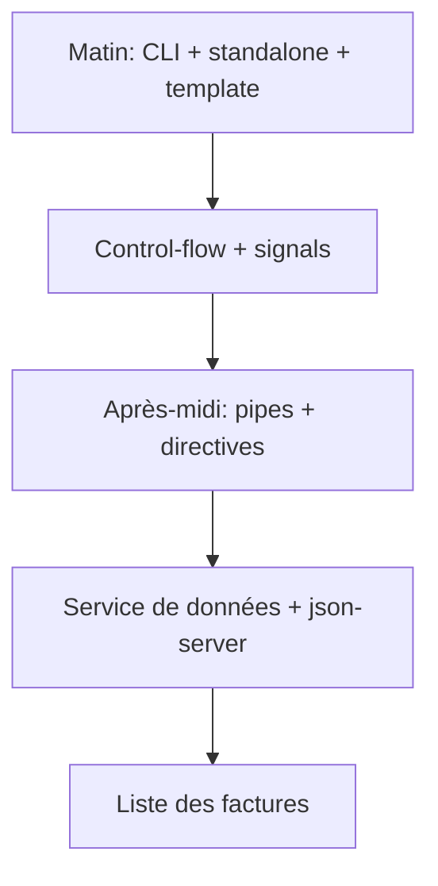
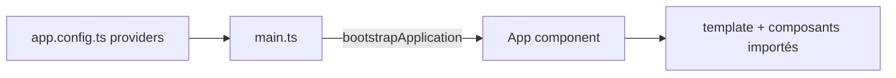
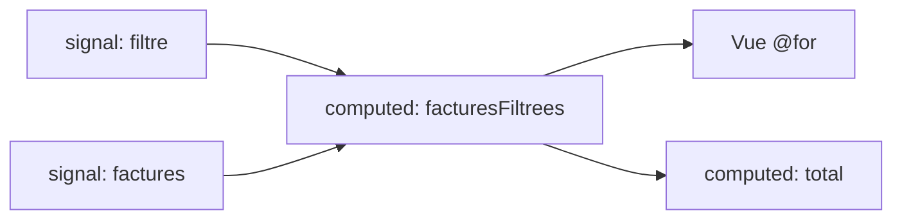

# Jour 1 — Fondations Angular et premier écran

> **Version 1.1.0 — 29/10/2026** · Angular 22.2 (CLI courante, standalone, signals, zoneless, OnPush) · Vitest · json-server 0.17.4

**Objectif** : à la fin de la journée, l'application affiche la liste des factures venant de json-server (dossier `backend/`, voir [README](../backend/README.md)), avec statuts colorés, montants formatés et filtre.



## Planning
| Horaire | Contenu |
|---|---|
| 09:00–10:30 | 1. Angular, SPA, CLI, workspace |
| 10:45–12:30 | 2. Composants standalone, binding, control-flow |
| 13:30–15:00 | 3. Signals (signal, computed, effect) |
| 15:15–16:30 | 4. Pipes et directives |
| 16:30–18:00 | 5. Données json-server + TP de synthèse |

---
## 1. Angular, SPA, CLI et workspace
### Concept
Angular est un framework SPA complet (routeur, formulaires, HTTP, DI, tests). La CLI (`ng new`, `ng generate`, `ng serve`, `ng build`, `ng test`) génère une structure cohérente. Fichiers clés : `angular.json`, `tsconfig.json`, `src/main.ts`, `src/app/app.config.ts`, `app.routes.ts`. Pas de NgModule par défaut : tout est **standalone**. Un projet Angular 22 est aussi **zoneless** et en **OnPush** par défaut ; `ng generate service` produit un service `@Service()`.



### Exemple hors projet (liste de tâches)
```bash
ng new todo --style=scss
ng g component todo-item
ng serve
```
Pourquoi la CLI : un composant généré = classe + template + style + spec, nommage uniforme. Dans le cas d'usage, plusieurs développeurs créeront des dizaines d'écrans « facture » : la CLI garantit qu'ils se ressemblent. Montrer aussi comment demander à une IA les commandes `ng g` adaptées (« feature factures avec liste, détail, service »), puis les vérifier.

### TP 1 — Initialiser le projet
1. `ng new rapprochement --style=scss` (répondre aux questions : pas de SSR ; zoneless et OnPush sont les défauts), ouvrir dans VS Code.
2. Lancer `ng serve`, repérer `main.ts`, `app.config.ts`, `app.routes.ts` ; lancer `ng test` pour voir la spec générée (Vitest).
3. Nettoyer le template racine (garder un `<h1>Rapprochement de factures</h1>`).
4. Créer l'arborescence : `src/app/core`, `src/app/shared`, `src/app/features/factures`.
5. `ng g c features/factures/facture-list`, l'importer dans le composant racine (`imports`) et l'afficher.
6. Copier le dossier `backend/` fourni à côté du projet ; `npm install && npm run api`.
7. Commit Git « init ».

---
## 2. Composants standalone, binding, control-flow
### Concept
Un composant standalone déclare ses dépendances (`imports`). Binding : `{{ }}`, `[prop]`, `(event)`. Contrôle de flux : `@if / @else`, `@for (… ; track …)`, `@empty`, `@switch`, `@defer`. Il remplace `*ngIf/*ngFor` (à présenter pour lire du code legacy).

Pourquoi le control-flow plutôt que `*ngFor` : intégré au compilateur (pas d'import), plus lisible, `track` obligatoire (performance), `@empty` natif.

### Exemple hors projet (liste d'utilisateurs)
```ts
@Component({
  selector: 'app-users',
  template: `
    @for (u of users; track u.id) {
      <li [class.admin]="u.role === 'admin'">{{ u.name }}</li>
    } @empty { <p>Aucun utilisateur</p> }
  `
})
export class UsersComponent { users = [{id:1,name:'Ada',role:'admin'}]; }
```
Cas d'usage : `@switch` affiche le badge du statut, `@empty` gère « aucune facture trouvée », `track f.id` évite de recréer le DOM à chaque rafraîchissement.

### TP 2 — Liste statique
1. Créer `core/models/facture.ts` : `interface Facture { id:number; numero:string; fournisseurId:number; dateEmission:string; dateEcheance:string; montantHT:number; tva:number; montantTTC:number; statut:'a_rapprocher'|'rapprochee'|'litige'; paiementId:number|null }`.
2. Dans `FactureListComponent`, déclarer 3 factures en dur.
3. Tableau avec `@for … track f.id` et `@empty`.
4. Statut affiché avec `@switch`.
5. Bouton « Détail » avec `(click)` qui écrit l'id en console.

---
## 3. Signals
### Concept
`signal()` = valeur réactive ; `computed()` = valeur dérivée mémoïsée ; `effect()` = effet de bord (log, stockage) ; `input()`, `output()`, `model()` pour les composants.



### Exemple hors projet (panier)
```ts
items = signal<{prix:number;qte:number}[]>([]);
total = computed(() => this.items().reduce((s,i)=>s+i.prix*i.qte,0));
add(i) { this.items.update(l => [...l, i]); }
```
Pourquoi `computed` plutôt qu'une méthode `getTotal()` dans le template : la méthode est rappelée à chaque détection de changement ; `computed` ne recalcule que si ses dépendances changent.

### TP 3 — Filtre réactif
1. `factures = signal<Facture[]>([...])`, `statutFiltre = signal<'tous'|Facture['statut']>('tous')`.
2. `facturesFiltrees = computed(...)`.
3. `totalTTC = computed(...)` sur les factures filtrées.
4. Un `<select>` qui appelle `statutFiltre.set(...)` via `(change)`.
5. Un `effect()` qui journalise le nombre de factures affichées (expliquer pourquoi ne pas écrire de signal dedans).

---
## 4. Pipes et directives
### Concept
- **Pipe** : transforme une valeur pour l'affichage (`date`, `currency`, `percent`, `async`, `json`). Pur par défaut, donc mémoïsé.
- **Directive d'attribut** : ajoute un comportement ou un style à un élément existant.
- **Composant** = directive + template.

Pourquoi un pipe plutôt qu'une méthode : n'est ré-évalué que si l'entrée change, réutilisable, testable seul, composable (`| date | uppercase`).
Pourquoi une directive plutôt qu'un composant : on modifie un élément existant (`<td>`, `<button>`) sans créer de DOM ; on peut cumuler plusieurs directives sur un élément.

### Exemple hors projet
```ts
@Pipe({ name: 'initiales' })
export class InitialesPipe implements PipeTransform {
  transform(nom: string) { return nom.split(' ').map(p => p[0]).join('').toUpperCase(); }
}

@Directive({ selector: '[appHighlight]', host: { '[style.background]': 'actif() ? "#ffe" : null', '(mouseenter)': 'actif.set(true)', '(mouseleave)': 'actif.set(false)' } })
export class HighlightDirective { actif = signal(false); }
```

### TP 4 — Pipes et directive
1. `currency:'EUR':'symbol':'1.2-2':'fr'` et `date:'dd/MM/yyyy'` ; enregistrer la locale `fr` (`registerLocaleData(localeFr)` + `LOCALE_ID`).
2. `ng g pipe shared/pipes/statut-label` : `a_rapprocher → « À rapprocher »`, etc.
3. `ng g pipe shared/pipes/echeance` : « en retard de N j » / « dans N j ».
4. `ng g directive shared/directives/statut-badge` : input `appStatutBadge` → classes CSS (vert/orange/rouge) via `host`.
5. Appliquer le tout au tableau ; comparer avec une version « méthode » en loggant le nombre d'appels.

---
## 5. Données json-server et service
### Concept
json-server expose `backend/db.json` en REST (`/factures`, filtres, tri `_sort`, pagination `_page`). Le fichier est **fourni** (voir `backend/README.md`) ; `npm run db:gen` le régénère de façon reproductible (`backend/scripts/generate-db.mjs`). La version **0.17.4 est volontairement épinglée** : la v1 change la syntaxe des requêtes (`_sort`, `_page`, `_expand`).

### TP 5 — Brancher la liste sur l'API
1. `npm run api` et tester `http://localhost:3000/factures?statut=litige`.
2. `ng g s core/services/facture` : lecture via `fetch` dans un signal (le J2 passera à `HttpClient`).
3. `factures = signal<Facture[]>([])` et méthode `charger()`.
4. Injecter avec `inject(FactureService)` et supprimer les données en dur.
5. Ajouter une recherche par numéro, combinée au statut dans un seul `computed`.
6. **Critère de réussite** : 200 factures affichées, pipes et badges appliqués, total TTC correct.

## Quiz
1. Pourquoi `track` est-il obligatoire dans `@for` ?
2. Différence `computed` / méthode dans le template ?
3. Quand créer une directive plutôt qu'un composant ?
