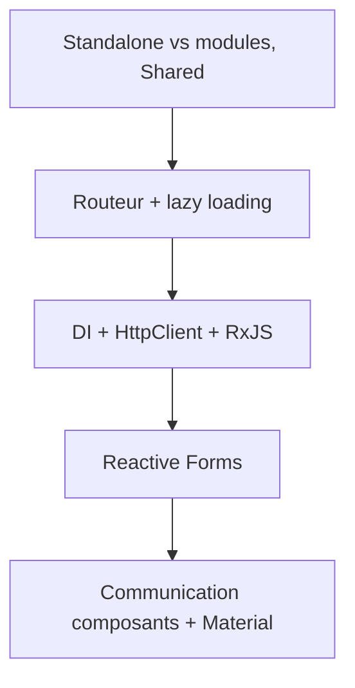
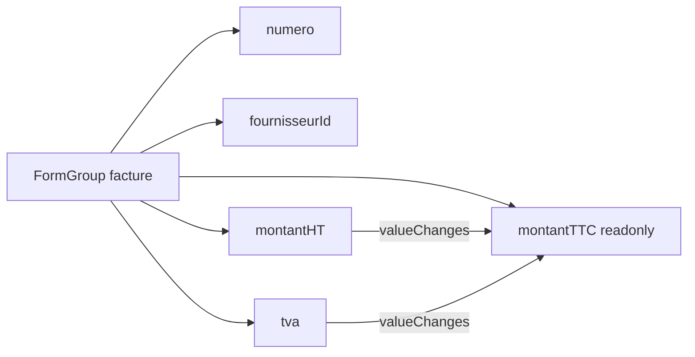

# Jour 2 — Architecture, navigation, HTTP et formulaires

> **Version 1.1.0 — 29/10/2026** · Angular 22.2 (CLI courante, standalone, signals, zoneless, OnPush) · Vitest · json-server 0.17.4

**Objectif** : application multi-écrans (liste, détail, création/édition) communiquant avec json-server via `HttpClient`, formulaires en Reactive Forms, UI Angular Material.



## Planning
| Horaire | Contenu |
|---|---|
| 09:00–10:30 | 1. Routeur, lazy loading, standalone vs NgModule |
| 10:45–12:30 | 2. DI, services, HttpClient, RxJS |
| 13:30–15:30 | 3. Reactive Forms |
| 15:45–16:45 | 4. Communication entre composants, Shared |
| 16:45–18:00 | 5. Angular Material + synthèse |

---
## 1. Routeur et architecture
### Concept
`provideRouter(routes)` dans `app.config.ts`, `<router-outlet>`, `routerLink`, paramètres `:id`, `loadComponent` / `loadChildren` pour le **lazy loading**, `withComponentInputBinding()` pour recevoir les paramètres d'URL en `input()`. Rappel NgModule (`declarations/imports/exports`) ; en standalone, le « Shared Module » devient un fichier d'exports (tableau de composants/pipes) ou de simples imports directs.

```mermaid
flowchart LR
    R[/ /] --> F[/factures]
    F --> FL[liste]
    F --> FD[/factures/:id]
    F --> FN[/factures/nouvelle]
    R --> RA[/rapprochement]
    R --> DB[/dashboard]
```

### Exemple hors projet (blog)
```ts
export const routes: Routes = [
  { path: '', redirectTo: 'articles', pathMatch: 'full' },
  { path: 'articles', loadChildren: () => import('./articles/articles.routes').then(m => m.ARTICLES_ROUTES) },
  { path: 'articles/:slug', loadComponent: () => import('./articles/article').then(m => m.ArticleComponent) },
  { path: '**', component: NotFoundComponent },
];
```
Pourquoi le lazy loading : le Dashboard (et ses graphiques) ne doit pas alourdir le bundle initial. Pourquoi un routeur plutôt qu'un `@if` : URL partageable, bouton retour, guards, chargement différé.

### TP 1 — Routes
1. `features/factures/factures.routes.ts` avec `''` (liste), `'nouvelle'`, `':id'`.
2. `loadChildren` pour `factures` dans `app.routes.ts`, plus redirection `''` et `**`.
3. `ng g c features/factures/facture-detail` ; lire l'id via `id = input.required<string>()` (avec `withComponentInputBinding()`).
4. Barre de navigation avec `routerLink` et `routerLinkActive`.
5. Vérifier dans l'onglet Network que le chunk `factures` est chargé à la demande.

---
## 2. Injection de dépendances, HttpClient, RxJS
### Concept
`@Service()` (ou `providedIn: 'root'`), `inject()`, `provideHttpClient()` pour configurer le client HTTP. `HttpClient` est **fourni par défaut depuis la v21** et utilise **Fetch** en v22 (`withFetch()` est déprécié). `HttpClient` renvoie des **Observables froids** (la requête part à l'abonnement). Opérateurs : `map`, `switchMap`, `catchError`, `debounceTime`, `distinctUntilChanged`. Interop signals : `toSignal()`, `async` pipe, `takeUntilDestroyed()`.

### Exemple hors projet (recherche de films)
```ts
results = toSignal(
  this.term$.pipe(debounceTime(300), distinctUntilChanged(),
    switchMap(t => this.http.get<Film[]>('/api/films', { params: { q: t } }))),
  { initialValue: [] });
```
Pourquoi un service plutôt que `http` dans le composant : séparation affichage/accès aux données, mutualisation, mocks faciles en test. Pourquoi `switchMap` : annule la requête précédente quand le filtre change.

### TP 2 — FactureService en HttpClient
1. `apiUrl` centralisée (`http://localhost:3000`) ; `HttpClient` est fourni par défaut. Ajouter `provideHttpClient(withInterceptors([...]))` uniquement pour configurer des intercepteurs.
2. `ng g s core/services/facture` génère un `@Service()` ; implémenter `list(params)`, `get(id)`, `create(f)`, `update(id,f)`, `delete(id)`.
3. Exposer `list` via `toSignal` ; signals `loading` et `error`.
4. Requêtes `?_sort=dateEcheance&_order=asc&statut=…&q=…`.
5. `FournisseurService` et affichage du nom du fournisseur (`forkJoin` ou `_expand=fournisseur`).
6. Message d'erreur (`@if (error())`) quand l'API est arrêtée.

---
## 3. Reactive Forms
### Concept
`FormControl`, `FormGroup`, `FormArray`, `NonNullableFormBuilder`, validators natifs, **validateurs personnalisés** (contrôle et groupe), validateurs asynchrones, `valueChanges`, états `touched/dirty/invalid`.

Pourquoi Reactive plutôt que template-driven : validation testable en TypeScript, formulaires dynamiques, validations croisées, typage fort.

> **Angular 22** : les **Signal Forms** (`form()`, `formField`) sont désormais stables. Les TP restent en Reactive Forms, que l'on retrouve dans la majorité des applications existantes ; Signal Forms est présenté comme l'alternative moderne, à explorer après la formation.



### Exemple hors projet (inscription)
```ts
form = inject(NonNullableFormBuilder).group({
  email: ['', [Validators.required, Validators.email]],
  pwd: ['', [Validators.required, Validators.minLength(8)]],
  pwd2: [''],
}, { validators: (g) => g.value.pwd === g.value.pwd2 ? null : { mismatch: true } });
```

### TP 3 — Formulaire de facture
1. `ng g c features/factures/facture-form` (création et édition).
2. Champs : `numero` (required, pattern `FA-\d{4}-\d{4}`), `fournisseurId` (select), `dateEmission`, `dateEcheance`, `montantHT` (min 0.01), `tva` (5.5/10/20).
3. `montantTTC` calculé via `valueChanges` (arrondi 2 décimales).
4. Validateur de groupe : échéance ≥ émission.
5. Validateur asynchrone : unicité du numéro (`GET /factures?numero=…`).
6. Messages d'erreur : `@if (ctrl.touched && ctrl.errors?.['required'])`.
7. Soumission : `create` ou `update`, puis redirection vers la liste.
8. Édition : `patchValue` depuis `FactureService.get(id)`.

---
## 4. Communication entre composants et Shared
### Concept
Parent → enfant : `input()` ; enfant → parent : `output()` ; deux sens : `model()`. Partage transversal : service + signals. Contenu projeté : `<ng-content>`.

### Exemple hors projet (notation)
```ts
@Component({ selector: 'app-rating', template: `...` })
export class RatingComponent {
  value = model(0);
  max = input(5);
  changed = output<number>();
}
```
Pourquoi un composant présentationnel : il ne connaît ni l'API ni le routeur, donc se réutilise partout et se teste avec de simples inputs.

### TP 4 — Composants réutilisables
1. `shared/components/statut-filter` : `model` du statut, utilisé dans la liste.
2. `shared/components/confirm-dialog` : `output` `confirmed` (bouton « Supprimer »).
3. Extraire `facture-row` (présentationnel) : `input.required<Facture>()`, `output` `selected`.
4. `shared/index.ts` regroupant les exports = équivalent « Shared Module » standalone.

---
## 5. Angular Material et synthèse
### Concept
`ng add @angular/material`, thème, `MatTable`, `MatFormField`, `MatSelect`, `MatDatepicker`, `MatSnackBar`, `MatDialog`. Atouts : accessibilité, cohérence. Coût : poids et courbe d'apprentissage.

### TP 5
1. `ng add @angular/material` ; thème personnalisé.
2. `mat-table` avec `matSort` et `matPaginator` (ou `_page` côté serveur).
3. Formulaire en `mat-form-field` + `mat-error`.
4. `MatSnackBar` pour les retours, `MatDialog` pour la confirmation.
5. Parcours complet : lister → filtrer → créer → éditer → supprimer.

## Quiz
1. Que se passe-t-il si on ne s'abonne pas à un Observable `HttpClient` ?
2. `switchMap` ou `mergeMap` pour une recherche ?
3. Quand préférer `model()` à `input()` + `output()` ?
