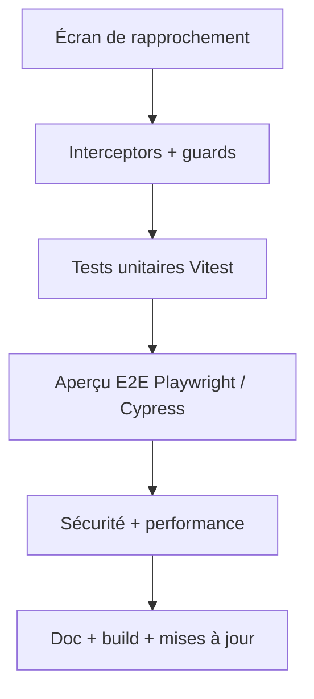
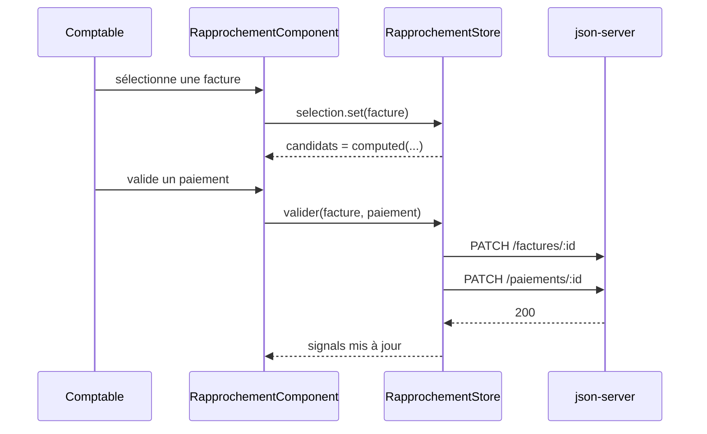
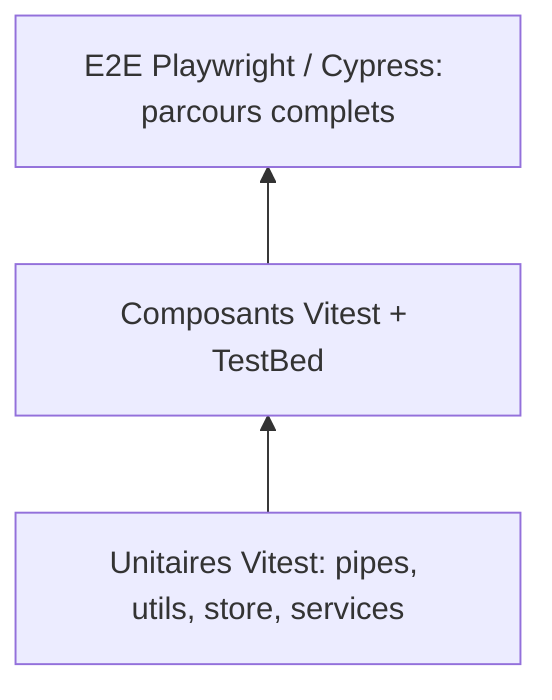

# Jour 3 — Rapprochement, qualité et mise en production

> **Version 1.1.0 — 29/10/2026** · Angular 22.2 (CLI courante, standalone, signals, zoneless, OnPush) · Vitest · json-server 0.17.4

**Objectif** : implémenter le métier (proposition et validation de rapprochements), tester (Vitest, aperçu E2E), sécuriser, documenter et construire l'application.



## Planning
| Horaire | Contenu |
|---|---|
| 09:00–12:30 | 1. Écran de rapprochement (computed, signals, formulaires) |
| 13:30–14:15 | 2. Guards, interceptors, gestion d'erreurs |
| 14:15–15:45 | 3. Tests unitaires avec Vitest |
| 15:45–16:30 | 3 bis. Aperçu E2E (Playwright / Cypress) |
| 16:30–17:15 | 4. Sécurité et performance (TP en démo ou optionnel) |
| 17:15–18:00 | 5. Documentation, build, mises à jour, bilan |

---
## 1. Écran de rapprochement
### Concept
Combiner signals, `computed` et service dans un **store léger** : état (`factures`, `paiements`, `selection`, `tolerance`) et dérivés (candidats, écart, totaux). Alternative désormais stable en v22 : `resource()` / `httpResource()` pour charger des données en signals.



Règle de scoring (à discuter en groupe) : +50 si montant = TTC (tolérance configurable), +30 si le libellé contient le numéro, +20 si IBAN = fournisseur, −1 par jour d'écart avec l'échéance. Le jeu `db.json` contient 40 paiements candidats construits pour ce scénario (dont des écarts de 0,01 €).

### Exemple hors projet (réconciliation de tickets de caisse)
```ts
candidats = computed(() => {
  const t = this.ticket();
  return t ? this.lignes().filter(l => Math.abs(l.montant - t.montant) <= this.tol()).sort(byScore(t)) : [];
});
```
Pourquoi `computed` : recalcul uniquement si le ticket, les lignes ou la tolérance changent ; aucune logique dans le template.

### TP 1 — Rapprocher
1. `ng g s core/services/paiement` (list, patch).
2. `ng g s features/rapprochement/rapprochement-store` : signals `factures` (statut `a_rapprocher`), `paiements` (non liés : `factureId === null`), `selection`, `tolerance`.
3. Fonction pure `score(facture, paiement)` dans `rapprochement.utils.ts`.
4. `candidats = computed(...)` triés par score décroissant.
5. `ng g c features/rapprochement/rapprochement` : deux colonnes, `@if (selection())`, `@empty`.
6. Formulaire réactif : tolérance en euros (`valueChanges` → `store.tolerance.set`), commentaire obligatoire si écart ≠ 0.
7. Action « Valider » : deux `PATCH` en `forkJoin` (facture : `statut`, `paiementId` ; paiement : `factureId`), puis mise à jour du store ; action « Litige ».
8. Dashboard (`features/dashboard`, lazy) : `computed` pour total TTC, taux de rapprochement, litiges ; carte en `@defer (on viewport)`.

---
## 2. Guards, interceptors, erreurs
### Concept
Interceptor fonctionnel (`HttpInterceptorFn`), guards fonctionnels (`CanActivateFn`, `CanDeactivateFn`), `ErrorHandler` global. Pourquoi un interceptor plutôt que du code dans chaque service : préoccupation transverse (en-tête, loader, erreur) écrite une seule fois.

### Exemple hors projet (jeton d'authentification)
```ts
export const authInterceptor: HttpInterceptorFn = (req, next) =>
  next(req.clone({ setHeaders: { Authorization: `Bearer ${inject(AuthService).token()}` } }));
```

### TP 2
1. `ng g interceptor core/interceptors/error` : `MatSnackBar` sur erreur HTTP, puis relance de l'erreur.
2. `ng g interceptor core/interceptors/loading` : compteur `pending` (signal) + barre de progression.
3. Enregistrer avec `provideHttpClient(withInterceptors([...]))`.
4. `ng g guard core/guards/unsaved-changes` (`CanDeactivateFn`) sur le formulaire de facture si `form.dirty`.

---
## 3. Tests unitaires avec Vitest
### Concept
La CLI courante configure **Vitest** par défaut (builder `@angular/build:unit-test`) ; la commande reste `ng test`. Karma/Jasmine ne sont plus le point de départ ; Protractor est abandonné.

Ce qui change par rapport à Jasmine :
- `describe`, `it`, `expect` restent identiques ; les espions passent par `vi` : `vi.fn()`, `vi.spyOn(obj,'m')`.
- Matchers proches de Jest : `toEqual`, `toHaveBeenCalledWith`, `toBeCloseTo`, `toThrow`.
- Temps simulé : `vi.useFakeTimers()`, `vi.setSystemTime(...)` ; tests asynchrones en `async/await`, sans `done`.
- Couverture : `npm i -D @vitest/coverage-v8`, puis `ng test --coverage` ; CI : `ng test --no-watch`.
- Le DOM est simulé (jsdom) ; un mode navigateur réel est optionnel.
- Un projet Karma bascule en remplaçant le builder par `@angular/build:unit-test`. La CLI propose aussi une migration automatique des specs Jasmine : vérifiez sa commande dans la doc de votre version.



Pourquoi tester `score()` en test pur : exécution en millisecondes, pas de TestBed, cas limites (écart de 0,01 €) faciles à énumérer. Les tests de composants sont réservés à ce qui touche au template (filtre, `@empty`, formulaire).

### Exemple hors projet (Vitest)
```ts
import { TestBed } from '@angular/core/testing';
import { describe, it, expect, vi, beforeEach, afterEach } from 'vitest';

describe('CartService', () => {
  it('calcule le total', () => {
    const s = TestBed.inject(CartService);
    s.add({prix: 10, qte: 2});
    expect(s.total()).toBe(20);
  });
});

describe('EcheancePipe', () => {
  beforeEach(() => { vi.useFakeTimers(); vi.setSystemTime(new Date('2026-10-15')); });
  afterEach(() => vi.useRealTimers());
  it('indique un retard', () => {
    expect(new EcheancePipe().transform('2026-10-10')).toContain('retard');
  });
});
```
Service HTTP :
```ts
it('GET /factures?statut=litige', () => {
  TestBed.configureTestingModule({ providers: [provideHttpClient(), provideHttpClientTesting()] });
  const svc = TestBed.inject(FactureService);
  const http = TestBed.inject(HttpTestingController);
  svc.list({ statut: 'litige' }).subscribe(r => expect(r.length).toBe(1));
  const req = http.expectOne(r => r.url.endsWith('/factures') && r.params.get('statut') === 'litige');
  expect(req.request.method).toBe('GET');
  req.flush([{ id: 1 }]);
  http.verify();
});
```
Composant avec inputs signal :
```ts
const fixture = TestBed.createComponent(FactureRowComponent);
fixture.componentRef.setInput('facture', facture);
await fixture.whenStable();
expect(fixture.nativeElement.textContent).toContain('FA-2026-0001');
```

### TP 3 — Tests unitaires
1. Vérifier le builder `@angular/build:unit-test` dans `angular.json` et lancer `ng test`.
2. Tester `score()` : montant identique, écart 0,01 €, IBAN différent, libellé contenant le numéro.
3. Tester `StatutLabelPipe` et `EcheancePipe` (temps figé avec `vi.setSystemTime`).
4. Tester `FactureService` avec `HttpTestingController`.
5. Tester `FactureListComponent` : 3 factures → 3 lignes, filtre « litige » → 1 ligne, cas vide (`@empty`).
6. Tester la validation de `FactureFormComponent` (échéance < émission → invalide) avec `vi.spyOn(service,'create')`.
7. `ng test --no-watch --coverage` ; viser > 70 % sur `core/` et `shared/`.

---
## 3 bis. Aperçu des tests End-to-End
### Concept
Un test E2E pilote un vrai navigateur sur l'application complète (front, routeur, API). Confiance maximale, mais plus lent et plus fragile : on le réserve aux parcours critiques. `ng e2e` demande quel outil installer si aucune cible n'est configurée.

| Critère | Playwright | Cypress |
|---|---|---|
| Installation Angular | `ng add playwright-ng-schematics` ou `npm init playwright@latest` | `ng add @cypress/schematic` |
| Exécution | Processus Node qui pilote le navigateur ; Chromium, Firefox, WebKit | Code exécuté dans l'onglet du navigateur ; interface interactive pédagogique |
| Attentes | Auto-wait sur les locators | Retry automatique sur les commandes |
| Mock réseau | `page.route()` | `cy.intercept()` |
| Debug | `--ui`, `--debug`, trace viewer, rapport HTML | Runner interactif, time-travel |

Pour les deux : sélecteurs stables (`data-testid` ou rôles ARIA), jeu de données maîtrisé, un test = un parcours. Pourquoi un E2E en plus des tests unitaires : seul lui détecte un routeur mal configuré, un lazy loading cassé ou une API au format inattendu.

### Exemple hors projet (Playwright)
```ts
import { test, expect } from '@playwright/test';

test('ajout au panier', async ({ page }) => {
  await page.goto('http://localhost:4200');
  await page.getByRole('button', { name: 'Ajouter' }).first().click();
  await expect(page.getByTestId('cart-count')).toHaveText('1');
});

test('API en panne', async ({ page }) => {
  await page.route('**/api/produits', r => r.fulfill({ status: 500 }));
  await page.goto('http://localhost:4200');
  await expect(page.getByText('Erreur de chargement')).toBeVisible();
});
```
Équivalent Cypress : `cy.visit('/')`, `cy.get('[data-testid=cart-count]').should('have.text','1')`, `cy.intercept('GET','**/api/produits',{statusCode:500})`.

### TP 3 bis — Démonstration guidée (45 min)
1. Ajouter des `data-testid` : `facture-row`, `btn-valider`, `statut-badge`.
2. Installer Playwright, configurer `webServer` pour lancer `ng serve` et `npm run api`.
3. Test « rapprochement » : ouvrir `/rapprochement`, sélectionner une facture, valider le premier candidat, vérifier qu'elle quitte la liste « à rapprocher ».
4. Test avec `page.route()` : API en erreur → le message de l'interceptor s'affiche.
5. `npx playwright test --ui` ; consulter le rapport HTML.
6. Restaurer `db.json` avant chaque run (copie du fichier fourni) pour des tests déterministes. Variante Cypress : `ng add @cypress/schematic`, puis `ng e2e`.

---
## 4. Sécurité et performance
### Concept
- Sécurité : échappement automatique des templates, `DomSanitizer` (éviter `bypassSecurityTrust*`), jamais `innerHTML` avec donnée utilisateur, protection XSRF de `HttpClient`, validation côté serveur, secrets hors du front, `npm audit`.
- Performance : lazy loading, `OnPush` (défaut en v22, à vérifier sur l'existant), `track`, `@defer`, `NgOptimizedImage`, analyse du bundle.

Pourquoi OnPush + signals : en v22, `OnPush` est déjà la stratégie par défaut ; le vrai levier est de garder des composants pilotés par signals, d'éviter les appels de méthodes dans le template et de mesurer dans le profiler.

### TP 4 (démo ou optionnel)
1. Ajouter un champ « commentaire » affiché via `{{ }}` ; tester `` et constater l'échappement.
2. Vérifier la stratégie de changement de détection (`OnPush` par défaut en v22) et repérer d'éventuels composants restés en `Eager`.
3. `ng build --stats-json` et comparer les chunks (initial vs lazy).

---
## 5. Documentation, mise à jour, bilan
### Concept
JSDoc + Compodoc, `ng update` (migrations automatiques), `ng generate` + IA : l'IA propose, le développeur vérifie (standalone, `inject()`, signals, control-flow, tests Vitest et non Jasmine).

### TP 5
1. Documenter `RapprochementStore` et `score()` (JSDoc : `@param`, `@returns`, `@example`).
2. `npx @compodoc/compodoc -p tsconfig.json -s`, consulter la documentation.
3. `ng update` (simulation : `--dry-run`) pour lister les mises à jour.
4. `ng build` en production ; servir `dist/` avec un serveur statique et rejouer le parcours complet.
5. Atelier IA : générer un composant « export CSV des rapprochements » et son test Vitest, relire, corriger, intégrer.

## Bilan et évaluation
- Démo de chaque stagiaire : « lister → rapprocher → litige → dashboard ».
- Grille d'auto-évaluation : CLI, standalone, signals, control-flow, pipes/directives, routeur, HTTP, Reactive Forms, Vitest, E2E.
- Pistes : NgRx SignalStore, SSR, i18n, E2E en CI.
